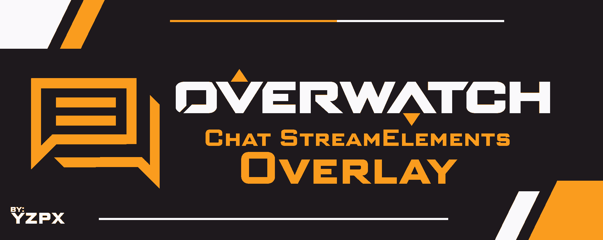

  

A **StreamElements Twitch Chat Overlay** inspired by the in-game chat UI from **Overwatch**.

Made for my friend **[AutismPossum](https://www.twitch.tv/autismpossum_)**, who asked for a working twitch chat with visuals visually similar to Overwatch's chat 

## Features

- Overwatch-inspired chat layout.
- Custom username and message colors.
- Option to use each user's default Twitch username color.
- Twitch badge support, with optional single-color badges.
- Full emote support: Twitch, 7TV, BetterTTV (BTTV), and FrankerFaceZ (FFZ).
- Smooth auto-scrolling to newest messages.
- Special formatting for system users (e.g. StreamElements and Nightbot).
- Optional username icons and system information icons.
- Configurable text, badge, and emote sizes.
- Adjustable message limit.
- Option to hide chat commands.
- Supports individual message deletion and user message purging.

## Built With

- HTML
- JavaScript
- [UnoCSS Runtime](https://unocss.dev/)
- [Lucide Icons](https://lucide.dev/)
- [7TV API](https://7tv.app/)
- [StreamElements Custom Widgets](https://streamelements.com/)

## Installation

1. Open your StreamElements dashboard.
2. Navigate to **Streaming Tools → Overlays**.
3. Add a **Custom Widget**.
4. Copy the project files into their respective sections:
   - `index.html` → HTML
   - `style.css` → CSS
   - `script.js` → JS
   - `fields.js` → Fields
5. Save your widget and add it to your overlay.

## Configuration

The widget includes customizable settings through the StreamElements Fields tab.

| Setting             | Description                              |
| ------------------- | ---------------------------------------- |
| Username Color      | Default username and badge color         |
| Message Color       | Chat message text color                  |
| Use Twitch Color    | Uses the chatter's Twitch username color |
| Show Badges         | Toggles Twitch badges                    |
| Single-Color Badges | Applies the username color to badges     |
| System Users        | Defines users with special formatting    |
| System Color        | Color used for system messages           |
| Text Size           | Chat text size                           |
| Badge Size          | Twitch badge dimensions                  |
| Emote Size          | Twitch emote dimensions                  |
| Max Messages        | Maximum messages displayed               |
| Hide Commands       | Hides messages starting with `!`         |

## Credits

Created by **YZPX**, for **AutismPossum**.

Inspired by the chat interface of **Overwatch**.

This is an independent fan-made project and is not affiliated with Blizzard Entertainment or StreamElements.